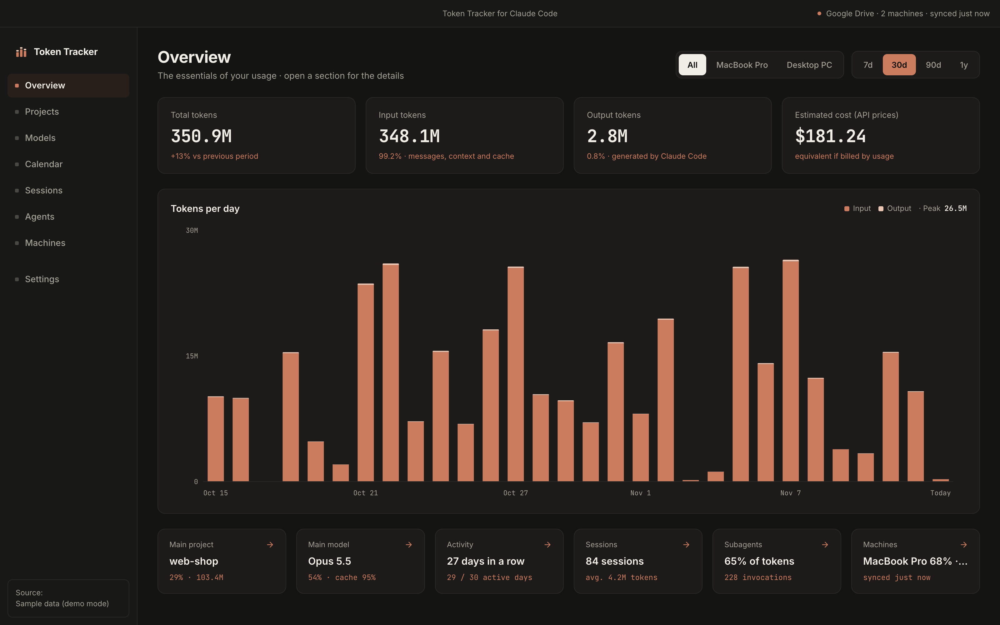
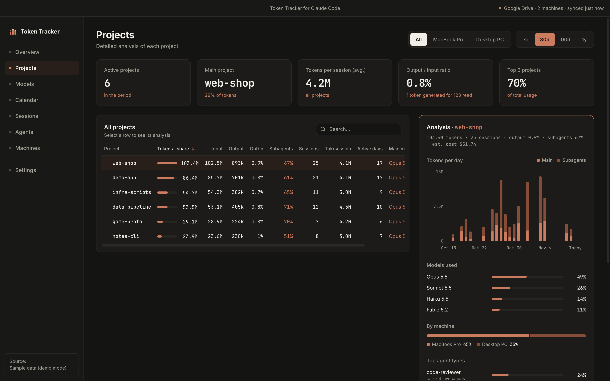
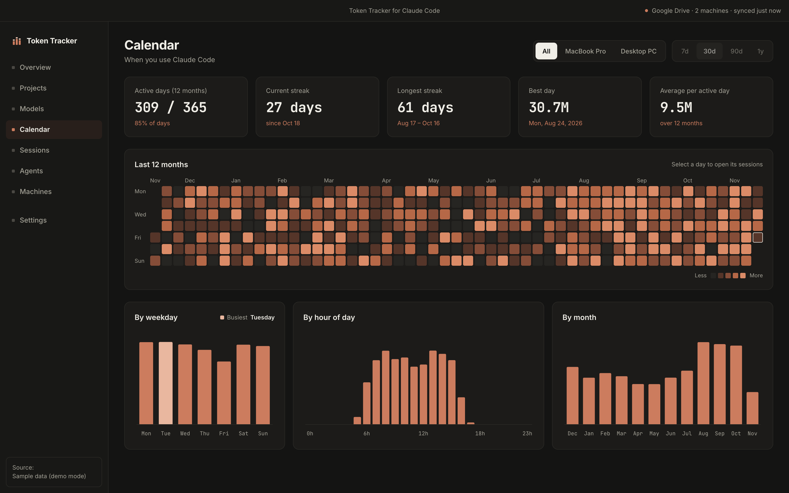
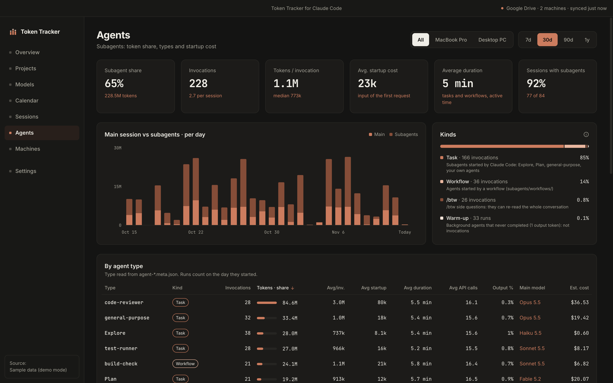
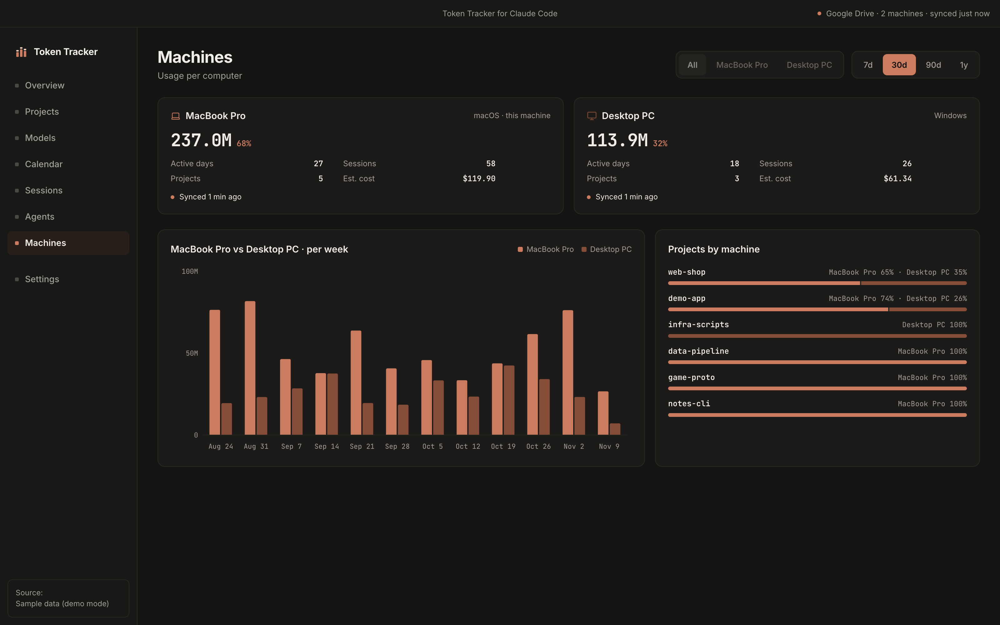
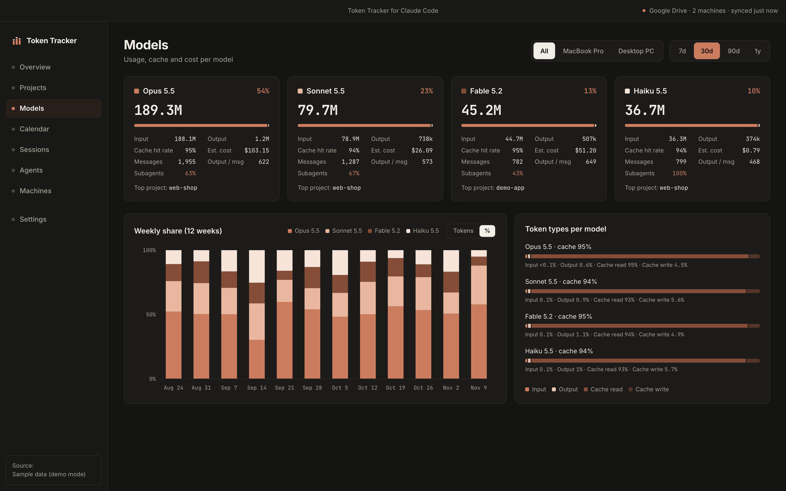

# Token Tracker for Claude Code

A desktop app for macOS and Windows that reads your local Claude Code session logs and shows a dark dashboard of your token usage: per day, project, model, session, subagent and machine.

Everything runs locally. No account, no API key, no telemetry, no network calls.



<sub>All screenshots are taken in demo mode, with generated sample data from two fake computers.</sub>

> Not affiliated with or endorsed by Anthropic. Claude and Claude Code are trademarks of Anthropic.

## Features

- **Overview** with the essentials: total, input and output tokens, estimated cost, tokens per day.
- **Projects**: usage per project, with a detailed analysis panel.
- **Models**: share, cache hit rate and estimated cost per model.
- **Calendar**: 12-month heatmap, streaks, usage by weekday, hour and month.
- **Sessions**: size and duration histograms, a sortable table and a detail drawer.
- **Agents**: what subagents cost you, by agent type, including their startup cost.
- **Machines**: combined usage of several computers, synced through your own Google Drive folder.
- **Permanent history**: the app keeps its own local database, so your history survives Claude Code's transcript cleanup.
- **CSV export** and an editable price table for the cost estimate.

| Projects                                                                     | Calendar                                                                                    |
| ---------------------------------------------------------------------------- | ------------------------------------------------------------------------------------------- |
|      |  |
| **Agents**                                                                   | **Machines**                                                                                |
|  |                  |
| **Models**                                                                   |                                                                                             |
|     |                                                                                             |

## Install

Download the latest version from the [Releases](https://github.com/diego24lavabo-cpu/token-tracker-for-claude-code/releases) page:

| System               | File                                           |
| -------------------- | ---------------------------------------------- |
| macOS, Apple silicon | `Token-Tracker-<version>-mac-arm64.dmg`        |
| macOS, Intel         | `Token-Tracker-<version>-mac-x64.dmg`          |
| Windows, installer   | `Token-Tracker-<version>-win-x64-setup.exe`    |
| Windows, no install  | `Token-Tracker-<version>-win-x64-portable.exe` |

On macOS, open the `.dmg` and drag the app into **Applications**. On Windows, run the setup, or start the portable `.exe` from any folder.

The builds are **not code-signed** yet (that needs a paid Apple Developer ID and a Windows code-signing certificate), so your system warns you the first time you open the app:

- **macOS 15 (Sequoia) and later**: open the app once; macOS says it could not verify it, click **Done**. Then open **System Settings → Privacy & Security**, scroll down to the message about Token Tracker for Claude Code and click **Open Anyway**, then **Open Anyway** again and confirm with your password or Touch ID. You only do this once.
- **macOS 14 (Sonoma) and earlier**: right-click (or Control-click) the app in Applications, choose **Open**, then confirm with **Open**.
- **Windows**: on the blue "Windows protected your PC" (SmartScreen) dialog, click **More info**, then **Run anyway**. The labels can appear in your system language.

To check a download, compare it with `SHA256SUMS.txt` on the release page (`shasum -a 256 <file>` on macOS, `Get-FileHash <file>` in PowerShell).

## Where the data comes from

Claude Code writes JSONL transcripts on your computer. The app scans every one of these folders that exists:

| Location                          | Notes                                |
| --------------------------------- | ------------------------------------ |
| `~/.claude/projects/`             | default on macOS and Linux           |
| `~/.config/claude/projects/`      | newer installs                       |
| `$CLAUDE_CONFIG_DIR/projects/`    | when the environment variable is set |
| `%USERPROFILE%\.claude\projects\` | Windows                              |

Only the usage numbers of each response are read (token counts, model, timestamps, project folder name). Only Claude Code is covered (CLI, IDE extensions, desktop Code tab); the claude.ai chat apps do not store per-message token counts locally.

## How usage is counted

- **Each response counts once.** Claude Code writes a streamed response as several lines and copies earlier lines when a session is resumed. Responses are deduplicated across all files by message id and request id.
- **Four token types stay separate**: input, output, cache write and cache read. Total input is the sum of input, cache write and cache read, which is everything sent to Claude.
- **Subagents are counted from their own transcripts** (`subagents/agent-*.jsonl`, workflow agents, `/btw` side questions, and the older inline format). The summary a parent session stores after a subagent run is ignored, so nothing is counted twice.
- **A project is the folder where the session was started.** If the shell moves into a subfolder during a session, the usage stays with the project.
- **Days and hours follow your system time zone.** Timestamps are stored in UTC.
- **Durations are active time.** The time between consecutive responses is added up, leaving out any pause longer than 30 minutes, so a session resumed the next day does not count as a day of work.
- **Cost is an estimate at API prices.** Each model's tokens are multiplied by the prices in an editable `pricing.json` in the app's data folder; writes to the 1-hour cache are priced at their own, higher rate. On a subscription this is only what the same usage would cost if billed per token. A model without a price shows no cost.
- **History is permanent.** Claude Code deletes old transcripts (after 30 days by default). The app copies the usage numbers into its own database and never removes them when a source file disappears.

## How sync works

Sync is **off by default**. When you turn it on in Settings, the app writes small JSON files into a `ClaudeTokenTracker` folder inside your local **Google Drive for desktop** folder ("My Drive", in any language), and reads the files written by your other machines. There is no Google API, no OAuth and no server: the Drive client on your computer does the transfer. With several Google accounts, or none found, you choose the folder.

Each machine writes only its own folder, `ClaudeTokenTracker/machines/<random id>/`: `machine.json` (name, platform, last sync) and one file per year (`2026.json`, a few MB at most). What is written:

- aggregated token counts per day and hour, project name (folder name only), model, agent type and kind
- one summary per session and per subagent run: random ids, start and end times, active time, token counts per model, the projects it worked in and the days it was active
- your machine's name and platform

What is **never** written: prompts, responses, code, file paths, subagent task descriptions.

Projects with the same name on several machines are merged, with a split per machine. After renaming a project folder, map the old name to the new one in Settings → Project aliases.

## Privacy

- The app makes no network calls.
- Your usage database stays in the app's user data folder on your computer.
- The only data that leaves the machine is the aggregated sync files described above, and only if you enable sync.
- Cost figures are an estimate "at API prices" from an editable price table. For subscription users it is only an equivalent.

## Build from source

Requirements: [Node.js](https://nodejs.org) 22.12 or newer and git. No C++ toolchain is needed: the SQLite module ships prebuilt binaries.

```sh
git clone https://github.com/diego24lavabo-cpu/token-tracker-for-claude-code.git
cd token-tracker-for-claude-code
npm install
npm run dev
```

| Command             | What it does                                                                   |
| ------------------- | ------------------------------------------------------------------------------ |
| `npm run dev`       | start the app with hot reload                                                  |
| `npm run dev:demo`  | start the app in demo mode (sample data)                                       |
| `npm run build`     | typecheck and build the app into `dist/` and `dist-electron/`                  |
| `npm test`          | run the unit tests                                                             |
| `npm run lint`      | run ESLint and the Prettier check                                              |
| `npm run typecheck` | run the TypeScript compiler without emitting                                   |
| `npm run dist:mac`  | build the two `.dmg` files into `release/` (on a Mac)                          |
| `npm run dist:win`  | build the setup and portable `.exe` into `release/` (on Windows)               |
| `npm run icons`     | render `build/icon.png` and `build/icon.icns` from `build/icon.svg` (on a Mac) |

Releases are built by GitHub Actions: pushing a `v*` tag (for example `v0.1.0`) runs [release.yml](.github/workflows/release.yml), which builds both platforms and creates a **draft** release with the notes of that version from [CHANGELOG.md](CHANGELOG.md).

### Demo mode

Demo mode shows generated sample data instead of your own: a year of fake sessions and subagents on "this computer", plus a second fake computer synced through a temporary folder. It never reads or writes your history, your Claude Code logs or settings, or Google Drive, and nothing can be changed in Settings. The sample data lives in a temporary folder that is emptied when the app quits.

- From source: `npm run dev:demo`.
- Installed app: start it with `--demo` (or the environment variable `TOKEN_TRACKER_DEMO=1`):
  - macOS: `open -n -a "Token Tracker for Claude Code" --args --demo`
  - Windows: `& "$env:LOCALAPPDATA\Programs\Token Tracker for Claude Code\Token Tracker for Claude Code.exe" --demo`

A demo window can stay open next to the normal one. `node scripts/gen-demo-data.mjs <folder>` writes the same kind of sample logs into a folder of your choice.

See [CONTRIBUTING.md](CONTRIBUTING.md) for the project layout and the rules for contributions.

## License

[MIT](LICENSE)

## Disclaimer

Not affiliated with or endorsed by Anthropic. Claude and Claude Code are trademarks of Anthropic. The Claude Code log format is not officially documented and can change between versions; if numbers look wrong after an update, please [open an issue](https://github.com/diego24lavabo-cpu/token-tracker-for-claude-code/issues).
